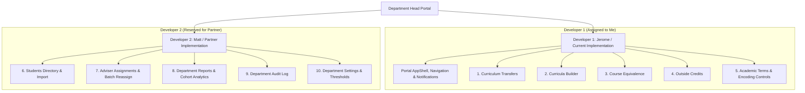

# Department Head Frontend Work Division & Coordination Plan

## 1. Overview of the Department Head Module

The **Department Head** portal in SAAIS provides department-level academic management, curriculum configuration, student and faculty oversight, term administration, and institutional reporting. An account with a separate Adviser assignment can also use the Adviser portal.

- Curriculum Transfers
- Curricula Builder (Versions, Terms & Courses/Slots)
- Course Equivalencies
- Outside Credits Recognition
- Department Student Directory
- Adviser Faculty Allocations & Reassignments
- Academic Terms & Grade Encoding Windows
- Department Academic Analytics & Reports
- Department Activity Audit Trail
- Department Settings & Scholastic Thresholds

The module is implemented as a React Single-Page Application (SPA) using Vite, Tailwind CSS v4, and Radix UI / shadcn-based design tokens adhering strictly to `mockup/Department Head`, `mockup/DESIGN.md`, and the merged production components in `src/components/`.

---

## 2. Identified Screens and Functional Groups

Through comprehensive inspection of `mockup/Department Head` (`*.dc.html`, `curricula-editor.js`, `department-head.js`) and `mockup/prototype-routes.js`, 10 distinct management screens (plus shared `Notifications`) have been identified and categorized into cohesive functional groups:

### Group A: Curriculum & Academic Program Administration
- **Screen 1: Curriculum Transfers** (`/department-head/curriculum-transfers`)
  - *Description*: Review adviser-endorsed applications to move students between curriculum versions. Features pending vs. history tabs (`?history=1`), transfer route visualizers, adviser justification reviews, and approve/reject decision dialogs.
  - *Complexity*: **Medium-High** (multi-tab state, decision modal with dynamic validation, reason capture, badge indicators).
- **Screen 2: Curricula** (`/department-head/curricula`)
  - *Description*: Manage versioned degree curricula (`BSCS · 2023–2024`, `BSCS · 2019–2020`, `BSIT · 2023–2024`) in an interactive curriculum builder (`Shape the path to graduation.`). Includes a version selector toolbar (`Edit version`, `Delete version`, `Add term`, `New course`), 4-tile summary stats (`Required units`, `Enrolled students`, `Effective from`, `Status`), positional term panels (`Year X · Semester Y`), course/slot rows with Edit/Delete actions, and full builder modals.
  - *Complexity*: **High** (hierarchical version → term → slot builder state, faculty-to-department cascading `New course` modal, 10 dialog flows with inline validation).
- **Screen 3: Equivalence** (`/department-head/equivalence`)
  - *Description*: Define and maintain one-to-one course equivalencies between paired curriculum versions (e.g., BSCS 2021 → BSCS 2024). Includes educational rule notices, paired dropdown selectors, equivalency table, and modal for adding equivalencies.
  - *Complexity*: **Medium** (dual-dropdown filtering, paired curriculum table, add equivalence dialog).
- **Screen 4: Outside Credits** (`/department-head/outside-credits`)
  - *Description*: Review and credit outside courses for shiftees and transferees from external universities or programs. Features recognition statistics, detailed credit mapping table, and comprehensive course crediting modal.
  - *Complexity*: **Medium** (statistics tiles, multi-field credit entry form modal, data table).

### Group B: Academic Operations & Term Scheduling
- **Screen 5: Academic Terms** (`/department-head/academic-terms`)
  - *Description*: Monitor semester operational dates, manage active terms, control grade encoding windows and deadlines, and execute PDF exports. Includes term metadata table, term detail view dialog, term creation modal, and grade encoding closure modal with warning notices.
  - *Complexity*: **High** (term timeline stats, 3 distinct modals, status badges, client-side PDF export integration).

### Group C: Student Directory & Faculty Advising Allocation
- **Screen 6: Students (Directory)** (`/department-head/students`)
  - *Description*: Department-wide student lookup and cohort browsing. Features multi-parameter search/filters (search input, curriculum select, adviser select, reset), student stats, a read-only checklist preview, and a spreadsheet dialog with fixed validation examples.
  - *Complexity*: **High** (live multi-field search and filtering, spreadsheet import modal with mock validation matrix, row click actions).
- **Screen 7: Adviser Assignments** (`/department-head/adviser-assignments`)
  - *Description*: Manage adviser-to-student load and allocations. Features batch row selection checkboxes, select-all and indeterminate state handling, allocation statistics, and a batch reassignment modal with new adviser selection and rationale.
  - *Complexity*: **High** (batch table selection state, indeterminate checkbox management, multi-student reassignment modal).

### Group D: Analytics, Governance, Audit & Department Settings
- **Screen 8: Department Reports** (`/department-head/reports`)
  - *Description*: Department academic performance snapshot. Features term and program selectors, 4 high-level stat cards, custom grade distribution visual bars, curriculum enrollment breakdown, cohort GWA table, full batch drill-down modal, and PDF export.
  - *Complexity*: **High** (data analytics visualization, multi-panel layout, cohort drill-down modal with full student lists, PDF export).
- **Screen 9: Audit Log** (`/department-head/audit-log`)
  - *Description*: Audit trail of department-scoped actions (record views, data updates, user logins). Features multi-field filter toolbar (acting person, student name/ID, action type, date range) and color-coded event logging table.
  - *Complexity*: **Medium** (multi-criteria client-side event filtering, formatted timestamp cells, status badges).
- **Screen 10: Settings** (`/department-head/settings`)
  - *Description*: Configure department scholastic standing rules, official sender email, and system backup records. Features backup alert callout, scholastic threshold percentage fields, notification settings, and backup recording modal.
  - *Complexity*: **Medium** (multi-section layout, threshold validation, backup recording modal).

---

## 3. Work Division Breakdown (~50/50 Split)

To ensure an equitable ~50/50 workload based on implementation effort, complexity, and domain cohesion, the module is divided into two logical halves:

| Metric | Developer 1 (Me / Jerome) | Developer 2 (Partner / Matt) |
|---|---|---|
| **Core Theme** | **Curriculum, Equivalencies, Outside Credits & Term Operations** | **Student Directory, Adviser Allocations, Analytics & Settings** |
| **Assigned Screens** | 5 Screens (Screens 1 to 5) + Shared DH Shell & Routing | 5 Screens (Screens 6 to 10) |
| **Estimated Effort** | 37 Complexity Points (~50%) | 37 Complexity Points (~50%) |
| **Functional Cohesion** | High (Curriculum & Academic Lifecycle) | High (People, Analytics & Governance) |

---

## 4. Detailed Assignment Specification

### A. Assigned to Me (Developer 1 — Jerome)
1. **Department Head Shared Infrastructure & Shell**:
- `DepartmentHeadLayout`: Renders the preview with a Department Head navigation section and stateful `NotificationBell`. Shared authenticated layout integration is pending.
   - `NotificationsPage` (`/department-head/notifications`) matching `mockup/notifications-page.js`.
   - Route configuration in `src/App.tsx` and route tree under `src/routes/department-head/`.
   - Dynamic breadcrumb generation and user trigger (`Dr. Andrea Dela Cruz`, Department Head · DCST).
2. **Screen 1: Curriculum Transfers** (`/department-head/curriculum-transfers`):
   - Stat tiles for pending, approved, and rejected counts.
   - `RecordTabs` (`Pending review` and `Decision history`) with `?history=1` URL query support.
   - Pending transfers table with "Review request →" action and advisory banner.
   - Interactive modal "Review curriculum transfer" with route visualization, adviser reason, `FormField`-validated decision notes textarea, and Approve / Reject actions.
   - Decision history view with past decisions and rationale.
3. **Screen 2: Curricula** (`/department-head/curricula`):
   - Toolbar with `Curriculum version` selector (`BSCS · 2023–2024`, `BSCS · 2019–2020`, `BSIT · 2023–2024`), `Edit version`, `Delete version`, `Add term`, and `New course`.
   - 4-tile `StatGrid` (`Required units`, `Enrolled students`, `Effective from`, `Status`).
   - Positional term panels (`Year X · Semester Y`) with course/slot tables and per-term/per-row edit and delete controls.
   - Builder modals (`Add version`, `Edit version`, `Delete record`, `Add term`, `Edit term`, `New course`, `Add course / slot`, `Edit course / slot`).
4. **Screen 3: Equivalence** (`/department-head/equivalence`):
   - Advisory notice for 1-to-1 course equivalence.
   - Curriculum pair selectors (`From` and `To` dropdowns).
   - Equivalency matrix table with mapped units and status badge.
   - "Add course equivalence" modal with subject selectors and rule caption.
5. **Screen 4: Outside Credits** (`/department-head/outside-credits`):
   - Outside credit statistics tiles (credited subjects, students, recognized units).
   - Credited courses data table (student, original course / units, school / origin, grade, equivalent subject / units, entry type badge).
   - "Credit an outside course" modal with student selection, entry type (Transferee / Shiftee), grades, and equivalent course mapping.
6. **Screen 5: Academic Terms** (`/department-head/academic-terms`):
   - Advisory encoding/backup policy notice.
   - Academic terms data table with status badges, `Close encoding`, and `View term` actions.
   - "Add academic term" modal.
   - "Academic term details" modal (key-value definition list).
   - "Close grade encoding" modal with warning notice and closure note.
   - PDF export trigger.

### B. Reserved for Partner (Developer 2 — Matt)
1. **Screen 6: Students (Directory)** (`/department-head/students`):
   - Student directory stats and active enrollments.
   - Search input, curriculum dropdown, adviser dropdown, reset filters button.
   - Responsive student directory table with row-click preview.
   - "Preview spreadsheet import" dialog with fixed validation results. It does not read or upload the selected file.
2. **Screen 7: Adviser Assignments** (`/department-head/adviser-assignments`):
   - Faculty allocation statistics.
   - Table with multi-select row checkboxes, select-all header, and indeterminate state.
   - Active selection counter and toolbar actions.
   - "Reassign selected students" modal with new adviser selection and rationale.
3. **Screen 8: Department Reports** (`/department-head/reports`):
   - Term and program selectors.
   - 4 departmental performance statistics cards.
   - Grade distribution visual bar chart (1.00–1.75, 1.76–2.50, etc.).
   - Department curriculum enrollment summary.
   - Cohort GWA performance table with "View students →" links.
   - Batch cohort drill-down modal displaying individual students.
   - PDF export trigger.
4. **Screen 9: Audit Log** (`/department-head/audit-log`):
   - Department activity filter bar (person name search, student search, action dropdown, date range).
   - Audit trail table with action badges (View, Change, Sign-in), timestamp, and record details.
   - Department scope notice and event counters.
5. **Screen 10: Settings** (`/department-head/settings`):
   - Overdue backup warning alert banner.
   - Scholastic standing thresholds form (Warning, Probation, Dismissal percentages).
   - Email sender address configuration.
   - Backups card and "Record a completed backup" modal.

---

## 5. Shared Components and Dependencies

The implementation strictly reuses the pre-built, production-tested components merged into the `dev` branch:

| Shared Component | Source Location | Usage in Department Head |
|---|---|---|
| `AppShell` | `@/components/features/app-shell` | Main layout container with sidebar, topbar, and content gutter |
| `AppSidebar` | `@/components/features/sidebar` | Collapsible Department Head navigation in the preview |
| `Topbar` | `@/components/features/topbar` | Header with breadcrumbs and notification trigger |
| `PageHeading` | `@/components/features/page-heading` | Display title, subtitle, and primary header action buttons |
| `Panel` | `@/components/features/panel` | Content sections with headers and borders |
| `DataTablePanel` | `@/components/features/data-table-panel` | Data tables with cream header, responsive stacked cards below 768px |
| `StatTile` | `@/components/features/stat-tile` | Dashboard metric cards (number, label, subtext) |
| `StatusBadge` | `@/components/ui/status-badge` | Passed, Failed, INC, Current, Older, Active, Open, Closed badges |
| `Button` | `@/components/ui/button` | Primary (forest `#2F4A12`), outline, ghost, and danger actions |
| `Dialog` | `@/components/ui/dialog` | Accessible Radix modals for all form previews and workflows |
| `Table` | `@/components/ui/table` | Responsive data table with IBM Plex Mono figures |
| `Badge` | `@/components/ui/badge` | Generic category and role tags |
| `Alert` | `@/components/ui/alert` | Advisory notices (`variant="advisory"`), warnings, and backup reminder banners |
| `FormField` | `@/components/features/form-field` | Accessible form labels and inline validation errors across filters & dialogs |
| `RecordTabs` | `@/components/features/student-record-header` | Gold-underlined tab switcher (`Pending review` vs. `Decision history`) |
| `Input` / `Select` / `Textarea` | `@/components/ui/*` | Form input fields matching 4px radius style guide |
| `Icons` | `@/components/icons` | Consistent 24px icon set (swap, book, list, check, cal, users, download, plus, alert, etc.) |

---

## 6. Implementation Status Tracker

| Screen / Feature | Assigned To | Status | Implementation Details |
|---|---|---|---|
| **DH Portal Shell & Notifications** | Jerome (Me) | **Preview** | Department Head navigation, notifications, and breadcrumbs. Shared authenticated layout integration is pending. |
| **Curriculum Transfers** | Jerome (Me) | **Completed** | `CurriculumTransfersPage.tsx`: `RecordTabs`, 3-stat grid, review modal with approve/reject |
| **Curricula Builder** | Jerome (Me) | **Completed** | `CurriculaPage.tsx`: Version selector, 4-stat grid, term panels, version/term/course/slot dialogs |
| **Equivalence** | Jerome (Me) | **Completed** | `EquivalencePage.tsx`: Curriculum pair selectors, equivalency table, add modal |
| **Outside Credits** | Jerome (Me) | **Completed** | `OutsideCreditsPage.tsx`: Stats, outside credits table, credit course modal |
| **Academic Terms** | Jerome (Me) | **Completed** | `AcademicTermsPage.tsx`: Term table, add term modal, term details modal, close encoding modal |
| **Students Directory** | Matt (Partner) | **Preview** | Search and filters, read-only checklist, spreadsheet preview |
| **Adviser Assignments** | Matt (Partner) | **Preview** | Bulk selection and sample reassignment |
| **Department Reports** | Matt (Partner) | **Preview** | Report filters, cohort details, and local PDF export |
| **Audit Log** | Matt (Partner) | **Preview** | Search and filters for sample events |
| **Settings** | Matt (Partner) | **Preview** | Sample standing rules, notification settings, and backup metadata |

---

## 7. Assumptions & Technical Decisions

1. **Strict UI Only**: All interactive forms, modal actions, and filters operate entirely in client-side memory using static mock data derived from `mockup/Department Head`. No backend, API, Supabase, or persistence logic is invoked.
2. **Design Fidelity**: Spacing (32px gutter, 16px below breakpoint), typography (Syne display headings, IBM Plex Sans body, IBM Plex Mono numeric values), color scheme (Forest `#2F4A12`, Cream `#FBF8EF`, Gold `#E0A82E`), and borders (6px panels, 4px inputs, 8px buttons) strictly mirror `mockup/DesignSystem.dc.html`.
3. **Adviser Navigation**: The Adviser portal uses its own routes and requires a separate Adviser role assignment. Adviser Assignments stays within Department Head.
4. **PDF Export Action**: The "Export PDF" buttons trigger a clean user-feedback toast and client-side printable view, preserving the prototype's export action without requiring external backend PDF generators.

---

## 8. Commit Log & Build Verification

### Completed Commits

| Commit Hash | Conventional Message | Scope |
|---|---|---|
| `2e264f4` | `docs(department-head): document frontend work division` | Coordination documentation and work division plan |
| `5ab5508` | `feat(department-head): add department head mock datasets and domain types` | Static mock models, data types, and initial records |
| `0f24dc9` | `feat(department-head): implement portal layout and role navigation shell` | Layout shell, router integration, partner placeholders |
| `24a10fd` | `feat(department-head): implement curriculum transfers review and decision UI` | Screen 1: Transfers, tabs, review dialog, approve/reject |
| `794e00e` | `feat(department-head): implement curricula versions and opened subjects page` | Screen 2: Version cards, offerings table, create/rename modals |
| `2980dce` | `feat(department-head): implement course equivalence mapping page` | Screen 3: Pair filtering, equivalency matrix, add modal |
| `636c470` | `feat(department-head): implement outside credits recognition page` | Screen 4: Credits stats, outside credit table, credit modal |
| `31cc6ec` | `feat(department-head): implement academic terms and grade encoding management page` | Screen 5: Active term stats, term table, closure modal, PDF export |

### Verification Results
- **TypeScript Typecheck (`tsc -b`)**: Passed with 0 errors.
- **Production Build (`vite build`)**: Passed in 1.50s; all route chunks properly code-split.
- **Unit Test Suite (`vitest run`)**: 3 test files passed, 41 unit tests passed.
